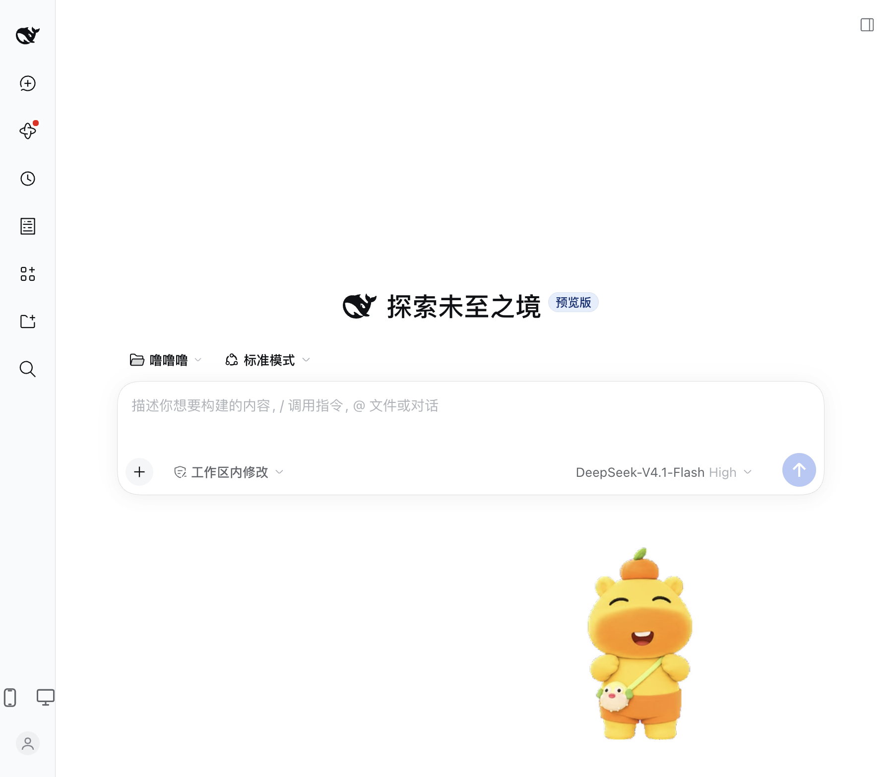

# dsh-lulu-pet

在 DeepSeek Harness 里养一只「水豚噜噜」：头顶小橘子、背斜挎包的暖黄色小水豚。



完全独立的插件——不依赖 dsh-pet，不启动 Electron，只往 Harness 页面里挂一层透明浮层，素材（15 段透明 WebM 动作 + 27 张表情）随包分发。

## 功能

- 待机小动作轮流播：呼吸、转圈、喝水、伸懒腰、整理斜挎包
- 单击回应：挥手 / 蹦跳
- 拖拽移动，位置记在 localStorage；双击弹表情包
- 设置页：显示开关、大小 300–640、停靠四角、表情开关、重置位置
- 所有动作 640×360 VP9 + alpha，深浅背景都干净

## 安装

```bash
dsh plugin install /path/to/dsh-lulu-pet
```

或在 Harness 插件管理里安装本地目录；装好后重启 DSH（或新开会话）。

## 设置

设置 → 左侧「噜噜桌宠」。

## 素材授权

角色与表情素材来自「水豚噜噜」公开内容，仅供个人使用；二次分发前请确认授权。

完整说明见 [docs/DETAIL.md](docs/DETAIL.md)。
