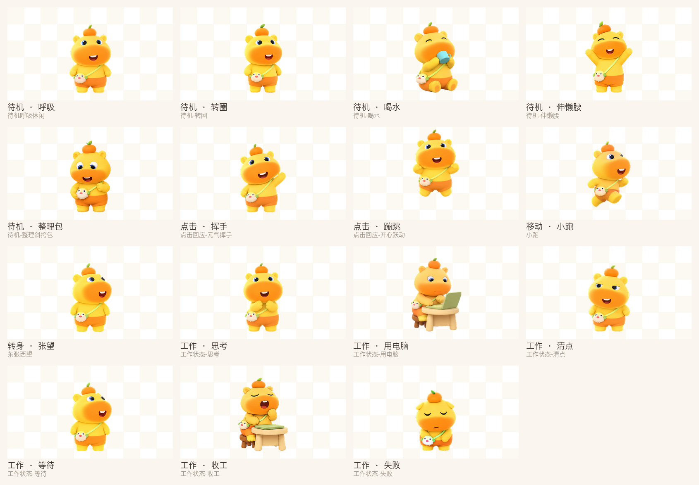
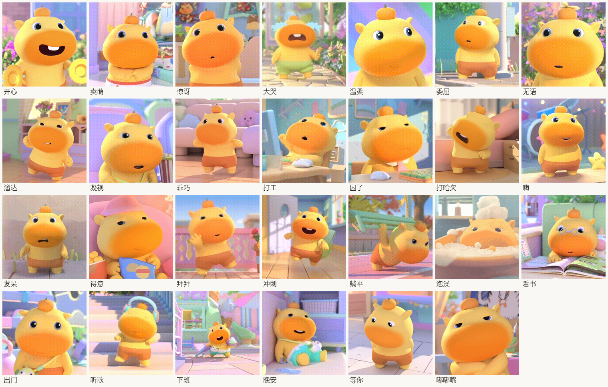

# 噜噜桌宠

一只头顶小橘子、背着斜挎包的小水豚，住在 DeepSeek Harness 的窗口里。她会在右下角安安静静地待着，时不时转个圈、喝口水、伸个懒腰，点一下会冲你挥手或蹦一下，拖一拖能换个地方，偶尔还会冒一张表情包。



## 她会做什么

| 场景 | 动作 |
| --- | --- |
| 待机 | 呼吸、转圈、喝水、伸懒腰、整理斜挎包（随机轮换，不会连着播同一条） |
| 单击 | 元气挥手 / 开心跃动（二选一） |
| 待机久了 | 有 16% 的概率先东张西望一下，再进入下一段待机 |
| 每个 50–100 秒 | 随机弹一张表情包，4 秒后缩回去 |
| 双击 | 立刻弹一张表情包 |

所有动作都是透明背景的 VP9 WebM（640×360，24fps，带 alpha 通道），所以贴在页面浅色/深色背景上都不会出现白底或黑边。

## 表情包

内置 27 张表情，来自「水豚噜噜」公众号的表情包系列（1–18 期），统一裁成 384×384：



开心、卖萌、惊讶、大哭、温柔、委屈、无语、溜达、凝视、乖巧、打工、困了、打哈欠、嗨、发呆、得意、拜拜、冲刺、躺平、泡澡、看书、出门、听歌、下班、晚安、等你、嘟嘟嘴。

如果你有更喜欢的图，直接替换 `assets/memes/` 里的同名 PNG（384×384 效果最好）即可，不用改代码。

## 交互

- **拖拽**：按住她拖到窗口里任何位置，松手就停在那儿；位置会记住。
- **单击**：她会回应你一下。
- **双击**：弹表情包。
- 页面滚动、缩放窗口后，她会自己回到可视范围内。

## 设置

打开 Harness 设置，左侧会多出「噜噜桌宠」一节：

- **显示桌宠**：临时藏起来 / 放出来。
- **大小**：300–640 px（默认 462，约等于一只正常桌宠）。
- **停靠角落**：右下 / 左下 / 右上 / 左上。
- **偶尔冒表情包**：关掉就只看动作、不出图。
- **回到默认位置**：把拖远的位置重置。

设置保存在浏览器 localStorage（键 `dsh-lulu-pet.prefs`），不写服务器。

## 安装

```bash
# 在装有 DSH 的机器上，把这个目录安装成本地 bundle
dsh plugin install /path/to/dsh-lulu-pet
# 或者在 Harness 的插件管理里选择「安装本地目录」
```

安装后重启 DSH（或新开一个会话）让 bundle 生效；客户端插件会随页面加载，无需另行构建。

## 技术说明

- **完全独立**：不依赖 dsh-pet、不需要 Electron、不读写 `~/.dsh/dsh-pet`。
- **资源走宿主 web server**：Host 半在 `/dsh-lulu-pet` 下注册一个静态前缀路由，提供 `meta.json`、`anim/*.webm`、`memes/*.png`；支持 Range 请求与缓存头。
- **渲染**：Client 半通过 `shell.overlay` 插槽挂一个 `position: fixed` 的透明层，用 `<video muted autoplay playsinline>` 播放带 alpha 的 WebM；命中区只覆盖角色本体，其余区域点击穿透。
- **素材体积**：15 段动作约 1.0 MB，27 张表情约 7.2 MB，合计约 8.6 MB。
- **浏览器要求**：支持 VP9 alpha 的 Chromium / Firefox（Harness 桌面端与 Web 端均可）。

## 素材来源

- 角色与动作：由「水豚噜噜」原始 sprite sheet 逐帧重排、合成、编码而来。
- 表情包：微信公众号「水豚噜噜」表情包系列 1–18 期，取首帧、统一尺寸。

仅供个人使用；若要二次分发，请先确认角色素材的授权。
